# 📘 Laporan Praktikum Pertemuan Ke-6, 7, 8

**Nama:** Rizwan Fauziani Ilham  
**NPM:** 4524210094  
**Mata Kuliah:** Praktikum Pemrograman Berbasis Web

# 📚 AuthBook – Library Management System

Aplikasi manajemen perpustakaan berbasis Laravel 12 dan Filament 3 untuk mengelola data buku, penulis, kategori, serta hak akses pengguna melalui dashboard admin.

<p align="center">
  
  
  
  
</p>

---

# ⚙️ INSTALASI

## 1. Clone Repository

```bash
git clone https://github.com/USERNAME/REPOSITORY.git
cd authbook
```

## 2. Install Dependencies

```bash
composer install
npm install
```

## 3. Setup Environment

```bash
cp .env.example .env
php artisan key:generate
```

## 4. Setup Database

```bash
php artisan migrate:fresh --seed
```

## 5. Build Assets

```bash
npm run build
```

## 6. Jalankan Aplikasi

```bash
php artisan serve
```

Buka browser:

```text
http://127.0.0.1:8000/admin
```

---

## 📋 Daftar Isi

- [Instalasi](#-instalasi)
- [Fitur Aplikasi](#-fitur-aplikasi)
- [Struktur Project](#-struktur-project)
- [Tugas 1 - Implementasi Dasar](#-tugas-1---implementasi-dasar)
- [Tugas 2 - Kustomisasi dan Pengembangan](#-tugas-2---kustomisasi-dan-pengembangan)
- [Tugas 3 - Analisis dan Dokumentasi aplikasi authbook](#-tugas-3---analisis-dan-dokumentasi-aplikasi-authbook).

---

# ✨ FITUR APLIKASI

| No. | Fitur | Keterangan |
|---|---|---|
| 1 | Authentication | Login admin panel |
| 2 | CRUD Books | Mengelola data buku |
| 3 | CRUD Authors | Mengelola data penulis |
| 4 | Search | Pencarian buku |
| 5 | Filter | Penyaringan data buku |
| 6 | Description | Deskripsi buku |
| 7 | RBAC | Hak akses Admin, Staff, Viewer |
| 8 | Dashboard Widget | Statistik perpustakaan |
| 9 | Chart | Grafik status buku |
| 10 | Categories | Kategori buku |
| 11 | Multiple Select | Memilih beberapa kategori |
| 12 | Seeder & Factory | Membuat data awal otomatis |

---

# 📂 STRUKTUR PROJECT

```text
authbook/
├── app/
│   ├── Filament/
│   │   ├── Resources/
│   │   │   ├── AuthorResource.php
│   │   │   ├── BookResource.php
│   │   │   └── CategoryResource.php
│   │   └── Widgets/
│   ├── Models/
│   │   ├── Author.php
│   │   ├── Book.php
│   │   ├── Category.php
│   │   └── User.php
│   └── Policies/
│       └── BookPolicy.php
├── database/
│   ├── factories/
│   ├── migrations/
│   └── seeders/
├── docs/
│   └── images/
├── resources/
├── routes/
├── tests/
├── composer.json
└── README.md
```
---

# 🎯 TUGAS 1 - IMPLEMENTASI DASAR

Implementasi dasar aplikasi manajemen perpustakaan menggunakan Laravel dan Filament.

## 1. Login Admin Panel

Halaman login untuk masuk ke dashboard administrasi.

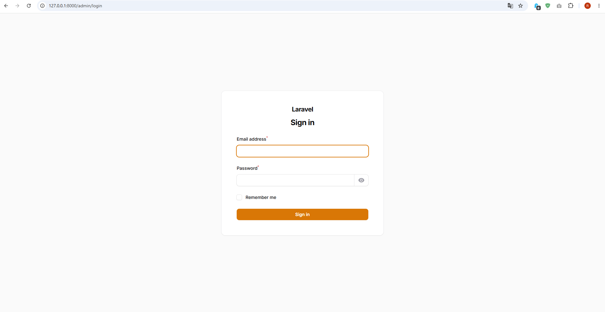

## 2. Dashboard Admin

Halaman utama untuk mengakses fitur pengelolaan perpustakaan.

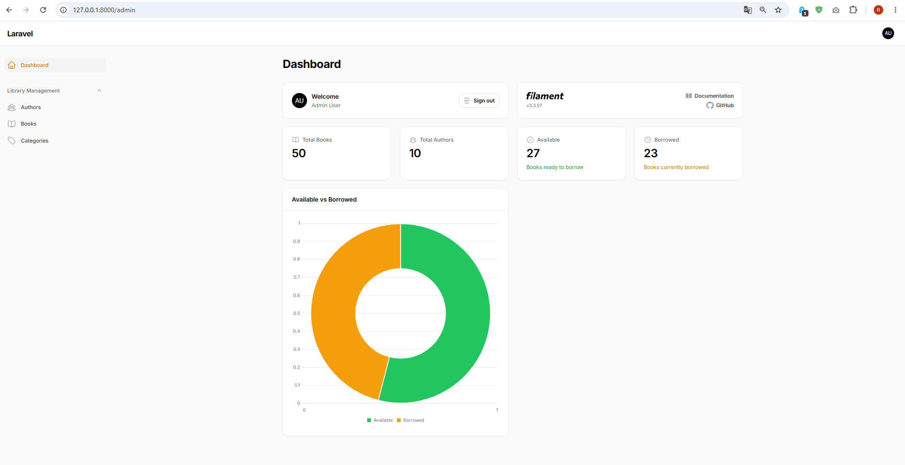

## 3. List Books

Menampilkan daftar buku yang telah tersimpan di database.

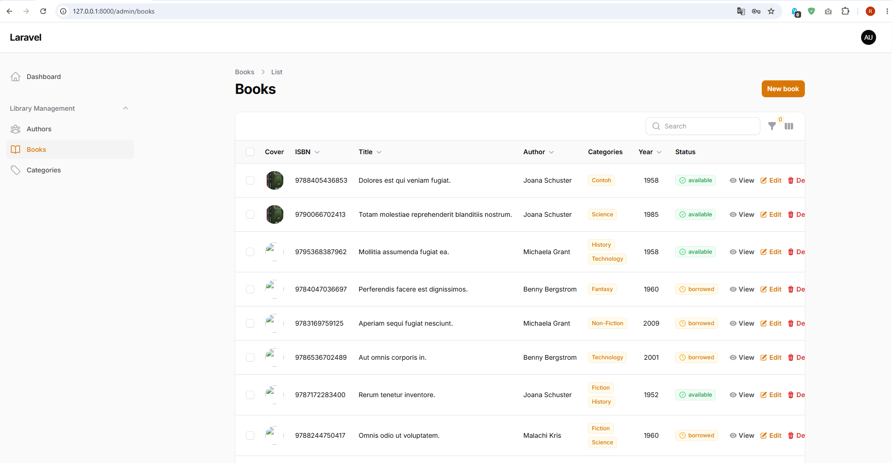

## 4. Form Create Book

Form untuk menambahkan data buku baru.

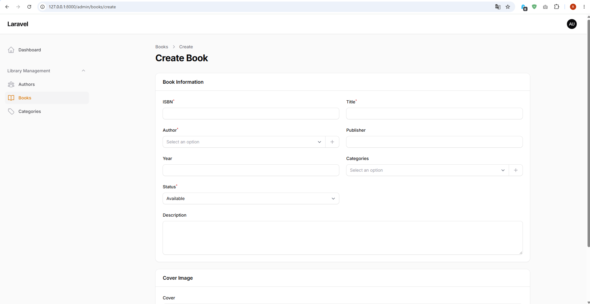

## 5. Fitur Pencarian Buku

Fitur pencarian untuk menemukan buku berdasarkan judul, ISBN, atau penulis.

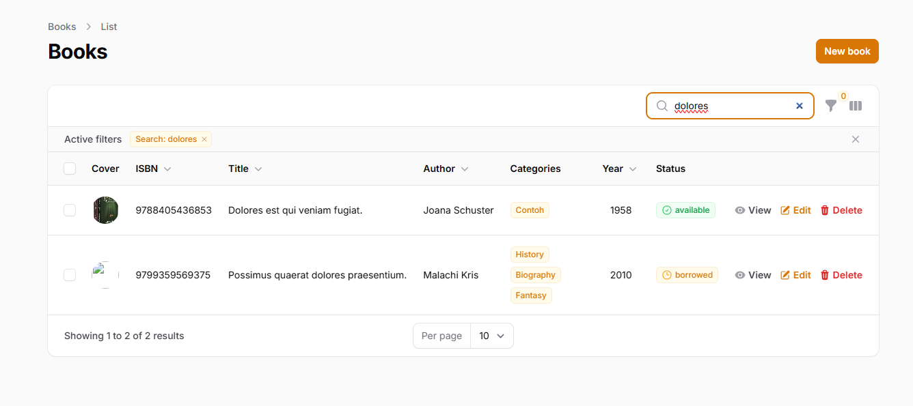

## 6. Fitur Filter Buku

Filter untuk menyaring data buku berdasarkan status, tahun terbit, dan penulis.

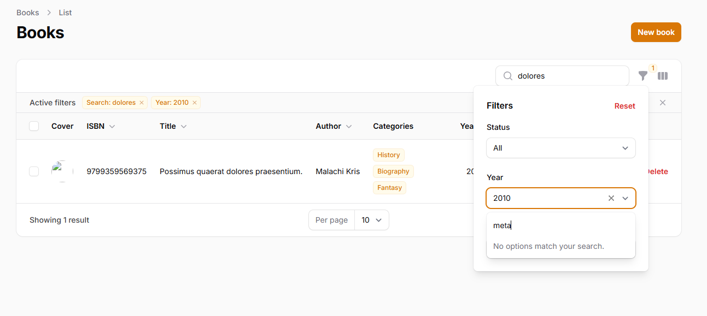

---

# 🚀 TUGAS 2 - KUSTOMISASI DAN PENGEMBANGAN

Pengembangan aplikasi dengan menambahkan empat fitur sesuai instruksi praktikum.

## 1. Tambah Field Description pada Book

Menambahkan kolom `description` pada tabel books untuk menyimpan deskripsi buku.

Implementasi:
- Migration menambahkan kolom description bertipe TEXT.
- Model Book menambahkan description ke `$fillable`.
- Resource menggunakan komponen Textarea.
- Factory menghasilkan deskripsi menggunakan `fake()->paragraph()`.

**Hasil Implementasi:**

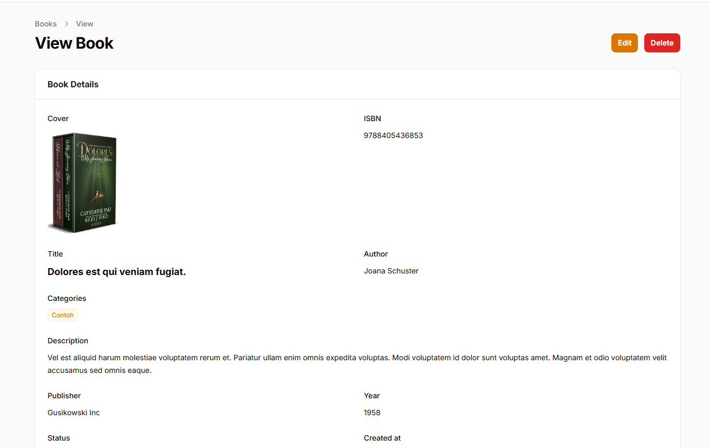

## 2. Role-Based Access Control (RBAC)

Menerapkan pembatasan hak akses berdasarkan tiga jenis pengguna.

| Role | View | Create | Edit | Delete |
|---|---|---|---|---|
| Admin | ✅ | ✅ | ✅ | ✅ |
| Staff | ✅ | ✅ | ✅ | ❌ |
| Viewer | ✅ | ❌ | ❌ | ❌ |

Implementasi:
- Menambahkan kolom role pada tabel users.
- Membuat UserSeeder untuk Admin, Staff, dan Viewer.
- Membuat BookPolicy.
- Mengatur izin akses berdasarkan role pengguna.

### Username dan Password

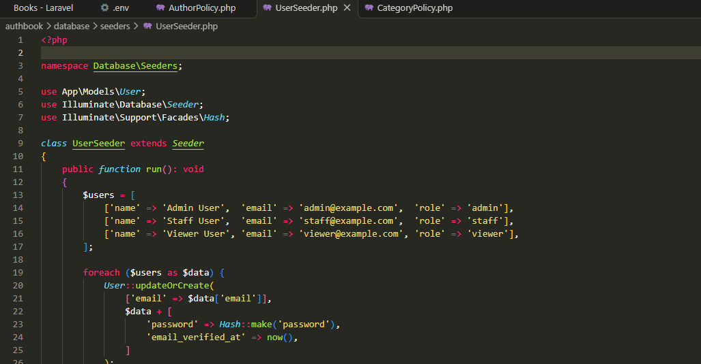

### Akses

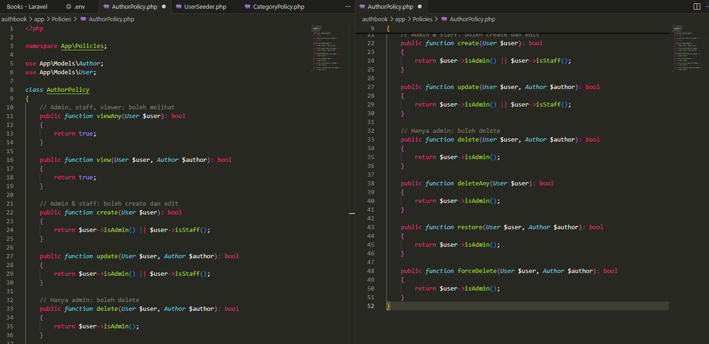


## 3. Dashboard Widget

Menambahkan widget statistik untuk memberikan informasi mengenai data perpustakaan.

Widget yang ditampilkan:
- Total Books.
- Total Authors.
- Books Available.
- Books Borrowed.
- Grafik perbandingan status buku.

**Dashboard Statistics:**


## 4. Kategori Buku

Menambahkan fitur kategori untuk mengelompokkan buku berdasarkan jenis atau bidang pembahasannya.

Implementasi:
- Membuat Model Category.
- Membuat Migration Categories.
- Membuat tabel pivot book_category.
- Membuat relasi many-to-many antara Book dan Category.
- Membuat CategorySeeder.
- Menambahkan Multiple Select pada form buku.
- Membuat CategoryResource.

**List Categories:**

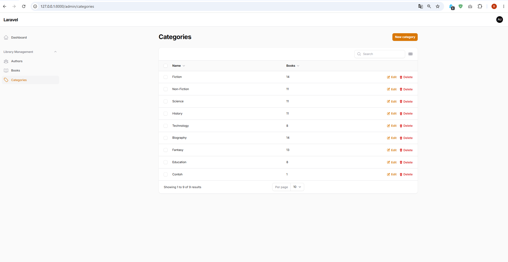

**Form Kategori Buku:**

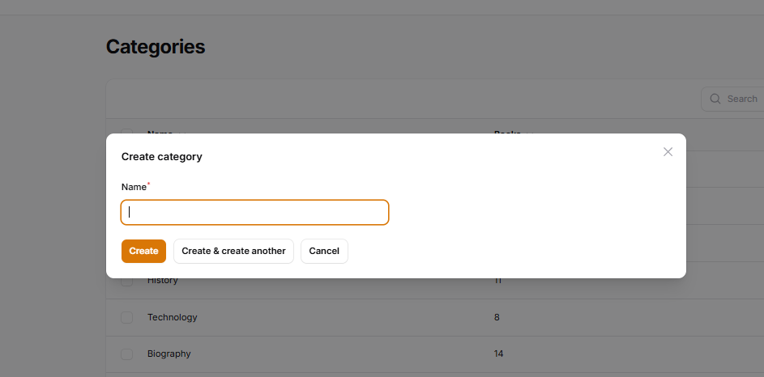

---


# 📘 TUGAS 3 – ANALISIS DAN DOKUMENTASI APLIKASI AUTHBOOK

---

# 1. PENJELASAN ARSITEKTUR

## Diagram ERD (Entity Relationship Diagram)

Entity Relationship Diagram (ERD) merupakan diagram yang digunakan untuk menggambarkan struktur database serta hubungan antar tabel dalam sebuah aplikasi.

Pada aplikasi AuthBook, database dirancang untuk mengelola informasi buku, penulis, kategori, pengguna, dan sesi login. Terdapat enam tabel utama, yaitu `authors`, `books`, `categories`, `book_category`, `users`, dan `sessions`.

Berikut merupakan diagram ERD dari database aplikasi AuthBook:

<p align="center">
  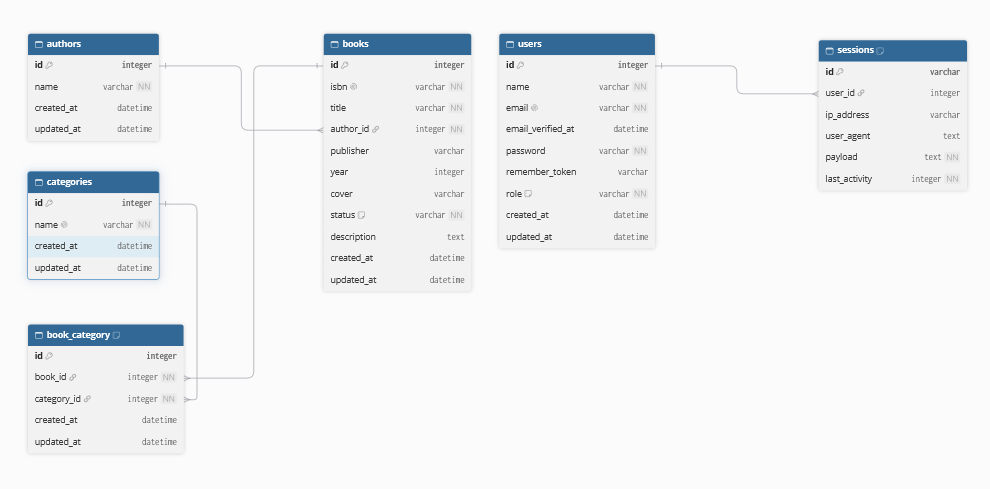
</p>

<p align="center">
  <i>Gambar 1. Entity Relationship Diagram Database AuthBook</i>
</p>

## Penjelasan Relasi Antar Tabel

Berdasarkan diagram ERD, terdapat beberapa hubungan antar tabel yang digunakan dalam aplikasi AuthBook.

**1. Tabel Authors dan Books**

Kedua tabel memiliki hubungan One-to-Many. Artinya, satu penulis dapat memiliki beberapa buku, sedangkan satu buku hanya memiliki satu penulis.

Hubungan tersebut menggunakan kolom `author_id` pada tabel books sebagai Foreign Key yang mengacu pada kolom `id` pada tabel authors.

**2. Tabel Books dan Categories**

Kedua tabel memiliki hubungan Many-to-Many melalui tabel perantara `book_category`.

Artinya, satu buku dapat memiliki beberapa kategori dan satu kategori dapat digunakan oleh beberapa buku.

Tabel `book_category` memiliki dua Foreign Key, yaitu:
- `book_id` yang mengacu pada tabel books.
- `category_id` yang mengacu pada tabel categories.

**3. Tabel Users dan Sessions**

Kedua tabel memiliki hubungan One-to-Many. Artinya, satu pengguna dapat memiliki beberapa sesi login.

Hubungan tersebut menggunakan kolom `user_id` pada tabel sessions yang mengacu pada kolom `id` pada tabel users.

Tabel sessions digunakan untuk menyimpan informasi sesi pengguna seperti alamat IP, user agent, payload, dan waktu aktivitas terakhir.

**4. Pengaturan Role pada Users**

Tabel users memiliki kolom `role` yang digunakan untuk membedakan hak akses pengguna dalam aplikasi.

Terdapat tiga jenis role yang diterapkan:
- Admin: Memiliki seluruh hak akses pengelolaan.
- Staff: Dapat melihat, menambahkan, dan mengedit data buku, tetapi tidak dapat menghapusnya.
- Viewer: Hanya memiliki hak untuk melihat data buku.

Pengaturan hak akses dilakukan menggunakan mekanisme Policy pada Laravel.

## Flow Aplikasi (Request hingga Response)

Flow aplikasi menjelaskan proses kerja sistem mulai dari pengguna mengakses aplikasi hingga sistem memberikan hasil atau response kepada pengguna.

Berikut merupakan alur proses aplikasi AuthBook:

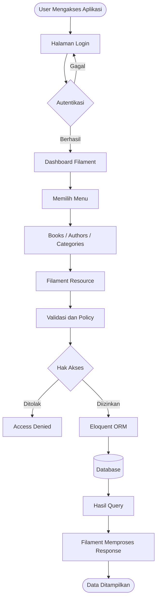

Penjelasan alur aplikasi:

1. **Request:** Pengguna membuka aplikasi melalui browser dan mengakses halaman login.
2. **Authentication:** Laravel melakukan pemeriksaan email dan password pengguna.
3. **Dashboard:** Apabila autentikasi berhasil, pengguna diarahkan menuju dashboard Filament.
4. **Resource:** Pengguna memilih menu pengelolaan seperti Books, Authors, atau Categories.
5. **Authorization:** Sistem memeriksa hak akses pengguna berdasarkan role melalui Policy.
6. **Processing:** Filament memproses permintaan dan Eloquent ORM menjalankan operasi database.
7. **Database:** Sistem mengambil, menambahkan, mengubah, atau menghapus data sesuai izin akses.
8. **Response:** Hasil pemrosesan dikembalikan dan ditampilkan melalui antarmuka Filament.

Dengan alur tersebut, pengguna dapat melakukan pengelolaan data perpustakaan melalui dashboard secara terstruktur.

---

# 2. PERBANDINGAN DENGAN PENDEKATAN TRADISIONAL

## Perbandingan CRUD Filament dan Manual

Dalam pengembangan aplikasi berbasis Laravel, terdapat dua pendekatan yang dapat digunakan untuk membuat fitur CRUD (Create, Read, Update, Delete), yaitu menggunakan Filament dan membuat CRUD secara manual.

Filament merupakan framework berbasis Laravel yang menyediakan komponen siap pakai untuk membangun panel administrasi. Sementara itu, pendekatan manual dilakukan dengan membuat sendiri proses pengelolaan data, form, tabel, validasi, dan tampilan menggunakan fitur Laravel.

Berikut merupakan perbandingan kedua pendekatan tersebut:

| Aspek | Filament | CRUD Manual |
|---|---|---|
| Pembuatan Form | Menggunakan komponen siap pakai | Membuat form sendiri |
| Tampilan | Sudah menyediakan UI administrasi | Mendesain tampilan sendiri |
| Tabel Data | Menggunakan Table Builder | Membuat tabel secara manual |
| Validasi | Menggunakan komponen validasi | Mengatur validasi sendiri |
| Pencarian | Tersedia konfigurasi pencarian | Membuat fitur pencarian sendiri |
| Filter | Menggunakan Filter Builder | Membuat filter secara manual |
| Hak Akses | Mendukung integrasi Policy | Mengatur authorization sendiri |
| Waktu Pengembangan | Relatif lebih cepat | Relatif lebih lama |
| Kustomisasi | Mengikuti komponen Filament | Lebih fleksibel |
| Pemeliharaan | Banyak fitur standar tersedia | Seluruh komponen dikelola sendiri |

## Kelebihan dan Kekurangan Masing-Masing Pendekatan

### A. Filament

**Kelebihan:**

1. Mempercepat proses pembuatan fitur CRUD.
2. Menyediakan komponen form dan tabel yang siap digunakan.
3. Mendukung fitur pencarian dan filter data.
4. Terintegrasi dengan Eloquent ORM.
5. Mendukung pengaturan hak akses menggunakan Policy.
6. Menyediakan dashboard dan widget yang dapat dikembangkan.
7. Mengurangi penulisan kode program yang berulang.

**Kekurangan:**

1. Tampilan dasar mengikuti struktur dan komponen Filament.
2. Membutuhkan pemahaman mengenai konfigurasi Filament.
3. Kustomisasi tertentu membutuhkan pengetahuan tambahan.
4. Bergantung pada package pihak ketiga.
5. Tidak semua kebutuhan aplikasi cocok menggunakan panel administrasi.

### B. CRUD Manual

**Kelebihan:**

1. Memiliki kebebasan penuh dalam mendesain tampilan.
2. Logika aplikasi dapat disesuaikan dengan kebutuhan.
3. Tidak bergantung pada framework panel administrasi.
4. Struktur kode dapat dirancang sesuai kebutuhan proyek.
5. Memiliki kontrol lebih luas terhadap setiap proses aplikasi.

**Kekurangan:**

1. Membutuhkan waktu pengembangan lebih lama.
2. Harus membuat form dan tabel sendiri.
3. Validasi input perlu dikembangkan secara manual.
4. Fitur pencarian dan filter harus dibuat sendiri.
5. Pemeliharaan membutuhkan pengelolaan kode yang lebih banyak.

## Kapan Sebaiknya Menggunakan Filament dan CRUD Manual?

**Penggunaan Filament**

Filament lebih sesuai digunakan ketika aplikasi membutuhkan panel administrasi dengan fitur pengelolaan data yang cukup banyak.

Contohnya:
- Aplikasi manajemen perpustakaan.
- Sistem pengelolaan inventaris.
- Sistem administrasi sekolah.
- Dashboard pengelolaan data perusahaan.

Pada project AuthBook, Filament digunakan untuk mengelola data buku, penulis, kategori, serta dashboard statistik. Dengan menggunakan Filament, proses pembuatan fitur CRUD dapat dilakukan lebih cepat karena tersedia komponen yang dapat langsung digunakan.

**Penggunaan CRUD Manual**

CRUD manual lebih sesuai digunakan ketika aplikasi membutuhkan tampilan yang sangat khusus, alur bisnis yang kompleks, atau kontrol penuh terhadap setiap komponen antarmuka.

Contohnya:
- Website dengan desain antarmuka khusus.
- Aplikasi dengan proses bisnis yang kompleks.
- Sistem yang membutuhkan interaksi pengguna di luar pola panel administrasi.

**Kesimpulan Perbandingan**

Berdasarkan perbandingan tersebut, Filament lebih efektif untuk pengembangan panel administrasi yang memiliki banyak fitur pengelolaan data. Sementara itu, CRUD manual lebih sesuai untuk aplikasi yang membutuhkan fleksibilitas tinggi dalam desain tampilan dan alur proses.

Pemilihan pendekatan sebaiknya disesuaikan dengan kebutuhan, kompleksitas, dan tujuan pengembangan aplikasi.

---

# 3. REFLEKSI PEMBELAJARAN

## Apa yang Dipelajari dari Praktikum Ini?

Melalui praktikum pengembangan aplikasi AuthBook, saya mendapatkan pengalaman dalam membangun aplikasi manajemen perpustakaan menggunakan Laravel 12 dan Filament 3.

Beberapa hal yang dipelajari selama praktikum antara lain:

1. Memahami konsep CRUD menggunakan Laravel dan Filament.
2. Membuat dan mengelola struktur database menggunakan Migration.
3. Menghubungkan tabel menggunakan relasi Eloquent ORM.
4. Menggunakan Factory dan Seeder untuk menghasilkan data secara otomatis.
5. Menerapkan Role-Based Access Control (RBAC) untuk membedakan hak akses pengguna.
6. Mengembangkan dashboard menggunakan Widget dan Chart.
7. Menggunakan komponen form, tabel, pencarian, dan filter pada Filament.
8. Memahami hubungan antara backend, database, dan antarmuka aplikasi.

Selain itu, saya juga memahami bahwa pengembangan aplikasi tidak hanya berfokus pada tampilan, tetapi juga harus memperhatikan struktur database, keamanan, dan pengelolaan hak akses pengguna.

## Kesulitan yang Dihadapi dan Cara Mengatasinya

Selama proses praktikum, terdapat beberapa kesulitan yang dihadapi dalam mengembangkan aplikasi AuthBook.

Berikut merupakan beberapa kendala beserta cara mengatasinya:

| No. | Kesulitan | Cara Mengatasi |
|---|---|---|
| 1 | Memahami struktur Resource Filament | Mempelajari struktur folder dan dokumentasi Filament |
| 2 | Mengatur relasi antar tabel | Memahami penggunaan belongsTo, hasMany, dan belongsToMany |
| 3 | Mengatur hak akses berdasarkan role | Menggunakan Policy dan fungsi pengecekan role pada Model User |
| 4 | Mengembangkan dashboard widget | Mempelajari penggunaan StatsOverview dan Chart Widget |
| 5 | Mengatur relasi kategori buku | Membuat tabel pivot book_category dan menghubungkannya menggunakan Eloquent |
| 6 | Menyesuaikan komponen form Filament | Mempelajari dokumentasi komponen dan konfigurasi Resource |

Kendala tersebut diatasi dengan mempelajari dokumentasi Laravel dan Filament, memeriksa kembali kode program, serta melakukan penyesuaian terhadap konfigurasi aplikasi.

## Rencana Pengembangan Aplikasi Selanjutnya

Aplikasi AuthBook masih dapat dikembangkan dengan menambahkan beberapa fitur agar lebih lengkap dan dapat digunakan sebagai sistem manajemen perpustakaan.

Rencana pengembangan selanjutnya meliputi:

1. **Sistem Peminjaman Buku:** Menambahkan fitur transaksi peminjaman dan pengembalian buku.
2. **Manajemen Anggota:** Menambahkan fitur untuk mengelola data anggota perpustakaan.
3. **Riwayat Peminjaman:** Menyimpan informasi aktivitas peminjaman dan pengembalian setiap anggota.
4. **Notifikasi Keterlambatan:** Memberikan informasi apabila buku melewati batas waktu pengembalian.
5. **Laporan Perpustakaan:** Menambahkan laporan jumlah buku, data anggota, dan aktivitas peminjaman.
6. **Export Data:** Menyediakan fitur ekspor laporan ke format PDF atau Excel.

Pengembangan tersebut diharapkan dapat menjadikan AuthBook sebagai aplikasi manajemen perpustakaan yang lebih lengkap dan membantu proses pengelolaan data perpustakaan secara digital.

---

# 📝 PENUTUP

Melalui praktikum ini, dilakukan pengembangan aplikasi manajemen perpustakaan menggunakan Laravel 12 dan Filament 3. Pengembangan mencakup implementasi CRUD, pencarian, filter, pengaturan hak akses pengguna, dashboard statistik, serta pengelolaan kategori buku.

Praktikum ini memberikan pemahaman mengenai penggunaan framework Laravel, pengelolaan database, relasi antarmodel, dan penerapan Role-Based Access Control (RBAC).

---

<p align="center">
  **Rizwan Fauziani Ilham – 4524210094**
  <br>
  Praktikum Pemrograman Berbasis Web
  <br>
  Universitas Pancasila
</p>
